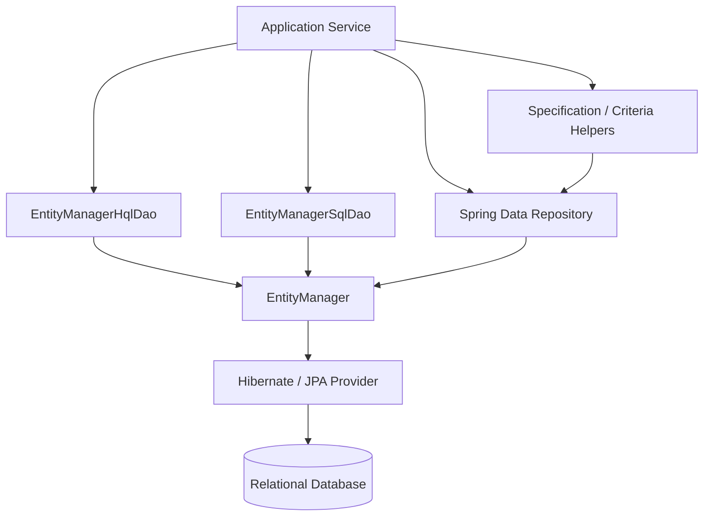
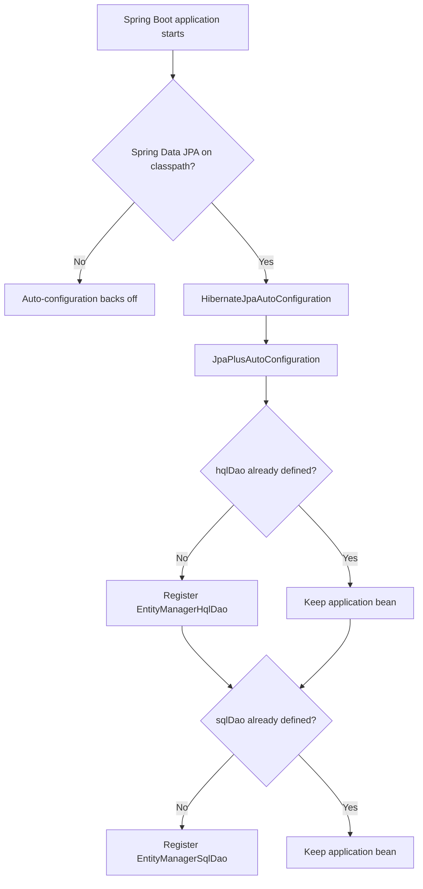

# Architecture

## Design principles

1. Spring Data JPA remains the persistence foundation; this project is an adapter/helper layer.
2. Core DAO APIs depend on `EntityManager` and Spring Data types, not on a specific database.
3. Transaction ownership stays with the application service.
4. Auto-configuration registers defaults but backs off when the application provides its own beans.
5. Business entities, repositories, controllers and database drivers belong to the consuming application or examples, not the library artifact.

## Runtime view

## Auto-configuration lifecycle

## Package boundaries

| Package | Responsibility | Notes |
|---|---|---|
| `autoconfigure` | Spring Boot bean registration | Must remain conditional and override-friendly |
| `persistence.dao` | HQL and Native SQL query helpers | No business entities |
| `convert` | Criteria predicates, page and VO conversion | Optional convenience layer above Spring Data |
| `bean` | Generic result/page abstractions | Avoid coupling to Web or Swagger |
| `annotation`, `aspect`, `utils` | Cross-cutting helpers | Candidate for a separate optional web extension |
| `examples/demo` | Demonstration business code | Excluded from the published library artifact |

## Transaction boundary

Read and write methods use the transaction context provided by the caller. A write operation such as batch `persist` should normally be called from a service method annotated with `@Transactional`. The library must not catch and suppress persistence exceptions because doing so can leave a transaction marked rollback-only while returning an apparent success.

## Query and pagination behavior

- Positional parameters use JPA's 1-based parameter index.
- Named parameters use `:name` in HQL/SQL and the same key in the parameter map (without the colon).
- `findPage` applies offset and max results; it does not infer or execute a count query.
- Native SQL result mapping remains provider/database dependent.
- Dynamic sort fields must be selected from a whitelist; they cannot be safely bound as ordinary query parameters.
